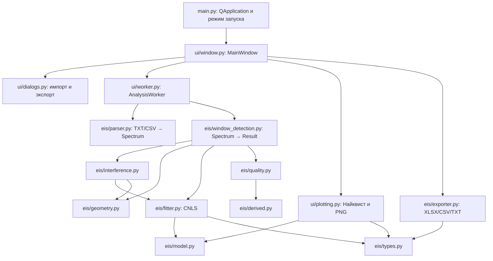

# Архитектура EISArcFit — первая версия

Документ описывает реализацию в репозитории на 22 октября 2026 года.

## Назначение и границы

EISArcFit — локальное настольное приложение Windows 10/11 x64 для оценки параметров одной дуги электрохимического импеданса. Рабочая модель: **Rs + (Rp ∥ CPE)**. Свободные параметры — Rs, Rp, Q и n; C_eff и f_max рассчитываются из них. Приложение импортирует TXT/CSV, выбирает диапазон, исключает подтверждённые отдельные выбросы, выполняет подгонку и сохраняет таблицы и графики.

Поддерживаются автоматический и ручной диапазоны, обработка всех или выделенных измерений, общий и выборочный экспорт. Данные каждого файла анализируются отдельно. Сервер, база данных и сетевое соединение для работы не требуются. Состояние сеанса не сохраняется между запусками.

## Слои и зависимости



Научное ядро `src/eis/` использует NumPy и SciPy и не зависит от Qt. Модуль экспорта таблиц использует openpyxl. Слой `src/ui/` использует PySide6 и pyqtgraph. Граница обмена между ними — структуры из `types.py`; передавать QWidget в ядро не требуется.

| Модуль | Ответственность |
|---|---|
| `src/main.py` | Создание QApplication, настройка стиля, обычный запуск, `--smoke-test`, `--check-data` |
| `src/ui/window.py` | Таблица результатов, выбор строк, команды пользователя, ручной диапазон, запуск worker, экспорт |
| `src/ui/worker.py` | Последовательная фоновая обработка файлов, запрос сопоставления столбцов, прогресс и отмена |
| `src/ui/dialogs.py` | Предпросмотр и сопоставление столбцов; выбор имени и форматов экспорта |
| `src/ui/plotting.py` | Экспериментальные точки, модель, экстраполяция, частота при наведении, выбор точки и PNG |
| `src/ui/fonts.py` | Читаемые системные шрифты, включая offscreen-режим проверки |
| `src/eis/types.py` | Контракты Spectrum, Fit, Result |
| `src/eis/parser.py` | Кодировка, разделитель, числа, распознавание формата, преобразование таблицы в Spectrum |
| `src/eis/config.py` | Численные ограничения и эвристические пороги |
| `src/eis/window_detection.py` | Координация анализа, кандидаты границы, окончательный fit, статус и примечания |
| `src/eis/interference.py` | Локальный разброс, робастная опорная модель, исключение отдельных точек 30–300 Гц |
| `src/eis/geometry.py` | Геометрический кандидат перехода к низкочастотному хвосту |
| `src/eis/fitter.py` | Ограниченная подгонка CNLS из нескольких начальных приближений, ковариация и устойчивость |
| `src/eis/model.py` | Комплексный импеданс Rs + (Rp ∥ CPE) |
| `src/eis/derived.py` | C_eff, f_max и распространение стандартных ошибок |
| `src/eis/quality.py` | Значимые предупреждения отдельно от информационных примечаний |
| `src/eis/exporter.py` | Точные числовые таблицы, 16 столбцов, временный файл и атомарная замена |

## Контракты данных

### Spectrum

- `path`: исходный файл.
- `frequency`: частота в Гц, порядок от высокой к низкой.
- `z`: комплексный импеданс Z′ + jZ″, в омах.
- `valid`: маска пригодности импортированных значений.
- `notes`: описание импорта и исключений.
- `eligible`: индексы допустимых для обработки точек: `valid`, `Im(Z) ≤ 0`, частота `≤ 100000 Гц`.

Импорт удаляет некорректные строки и точные дубликаты, сортирует принятые измерения и документирует это в примечаниях. Одинаковые частоты с различными импедансами сохраняются. Исходный файл не перезаписывается. После импорта анализ использует маски и индексы, сохраняя значения принятого спектра без интерполяции или замены. NumPy-массивы технически изменяемы, поэтому неизменность принятых значений является контрактом кода, а не запретом на уровне типа.

### Fit

Хранит `params = [Rs, Rp, Q, n]`, стандартные ошибки `se` или `None`, полную ковариацию или `None`, приведённый χ², нормированные комплексные остатки, обусловленность Jacobian, флаги попадания к границе и устойчивости стартов. Производные свойства предоставляют C_eff, f_max и их стандартные ошибки.

### Result

Связывает исходный Spectrum, окончательный Fit и `used` — индексы точек в принятом спектре. Дополнительно хранит:

- `status`, `reasons` — итоговый статус и значимые причины проверки/ошибки;
- `notes` — информационные примечания анализа;
- `manual` — использован ли ручной диапазон;
- `candidates` — диагностика проверенных диапазонов;
- `noise_indices`, `noise_suspects`, `noise_threshold` — исключённые и подозрительные точки, применённый порог.
- `unstable_indices` — точки за началом нестабильного низкочастотного участка.

Значения в Result имеют полную точность. Округление и десятичная запятая применяются только при отображении таблицы.

## Путь одного файла

1. MainWindow создаёт задание `(номер строки, путь, Spectrum или None, ручные границы или None)`.
2. AnalysisWorker использует уже импортированный Spectrum либо читает файл через `inspect_text` и `spectrum_from_table`. Повторная обработка в том же сеансе использует Spectrum из памяти; внешнее редактирование файла автоматически не перечитывается.
3. При неоднозначных столбцах worker посылает `mapping_needed` и ждёт ответа через `threading.Event`. Диалог находится в главном потоке. Явно выбранное сопоставление можно повторно использовать для той же структуры таблицы.
4. `analyze` проверяет помехи, формирует допустимые индексы и применяет ручные границы, если они заданы.
5. В автоматическом режиме сначала проверяется нестабильный низкочастотный участок, затем перегиб на оставшейся части спектра. Геометрические кандидаты проверяются по комплексным остаткам относительно модели предшествующего участка. В ручном режиме подгоняется заданный участок.
6. Выполняются оценка качества и проверка чувствительности Rp к удалению двух последних низкочастотных точек.
7. Worker отправляет `completed(номер строки, Result)`. MainWindow обновляет строку и выбранный график.
8. Ошибка одного файла не останавливает следующие задания.

## Импорт и соглашения

Поддерживаются TXT и CSV, десятичные точка и запятая, распространённые разделители, UTF-8 и однобайтовые кодировки с возможностью ручного выбора. Частота переводится в Гц по заголовку или явному выбору единицы.

Точный профиль SmartStat `N / F, Гц / Re, Ом / Im, Ом` использует подтверждённое пользователем соглашение: столбец Im означает **−Im(Z)**. Для обычных заголовков учитывается математический знак Im или −Im. Знак не выбирается по большинству положительных значений.

Точки выше 100 кГц и ниже оси Найквиста остаются доступны для отображения, но исключены из всех этапов обработки. Точка ровно 100 кГц допустима. Ручной диапазон не отменяет эти ограничения.

## Математическая модель

```text
Z(ω) = Rs + 1 / [1/Rp + Q·(jω)^n]
ω = 2πf
```

Ограничения: Rs, Rp, Q > 0; `1e-6 ≤ n ≤ 1`. Rs, Rp и Q оптимизируются в логарифмических координатах с численными границами −50…50. Используется `scipy.optimize.least_squares`, несколько стартов n и Rp, а для последовательных участков — также предыдущее решение.

Окончательный fit минимизирует действительные и мнимые остатки, разделённые на измеренный |Z|. Приведённый показатель:

```text
χ² = Σ[(ΔZ′ / |Z|)² + (ΔZ″ / |Z|)²] / (2N − 4)
```

Это мера относительного согласия модели и данных. Без известных экспериментальных стандартных отклонений каждой точки она не является строгим статистическим χ² для вероятностных выводов.

Ковариация оценивается по SVD Jacobian при числе обусловленности меньше `1e7`; затем переводится из координат оптимизации в физические параметры. Стандартные ошибки локальны и условны относительно выбранной модели и диапазона. Неопределённость выбора диапазона и выбросов автоматически в них не включается.

```text
ω_max = (Rp·Q)^(-1/n)
f_max = ω_max / (2π)
C_eff = 1 / (Rp·ω_max)
```

Производные величины рассчитываются в логарифмической форме с проверкой представимости чисел. Их ошибки учитывают полную ковариацию. Число свободных параметров остаётся равным четырём.

## Диапазон и помехи

Автоматическая граница допускается на 2000 Гц и ниже. Геометрический детектор ищет разворот сглаженного угла касательной на нисходящей стороне дуги; абсолютный подъём выше точки перегиба не требуется. Для подтверждения нужны три последовательных направленных отклонения от модели предшествующего участка на частотах этих точек. При ручном выборе ограничение 2000 Гц не действует.

Нестабильный низкочастотный участок определяется отдельно по устойчивому сочетанию локального разброса и отклонения от модели. Он отображается отдельными метками. Полоса 30–300 Гц относится к исключению отдельных возможных сетевых помех.

Отдельный механизм сетевых выбросов работает только в полосе **30–300 Гц включительно**:

1. Находит нерегулярный локальный разброс по соседям в log(f), вычитая плавную медианную кривизну.
2. Строит робастную опорную модель с Soft-L1.
3. Считает кратчайшее расстояние до модельной линии Найквиста относительно |Z|.
4. Уточняет маску не более трёх проходов; точка может вернуться в fit.
5. Окончательный порог — `max(0.02, median(background) + 3·scaled_MAD)`, где `scaled_MAD = 1.4826·MAD`.

Хорошие точки полосы сохраняются. Плавное несоответствие модели не объявляется автоматически сетевым выбросом. При невозможности надёжной проверки точки сохраняются и выдаётся предупреждение. После отбора выполняется обычный CNLS без робастной функции потерь.

Положительная последовательная индуктивность автоматически не добавляется. `tools/check_inductance.py` — отдельная диагностическая проверка 3.1, не меняющая маски приложения. Для 3.1 эта модель не объяснила высокочастотное отклонение; автоматического отсечения выше 1000 Гц для этого файла нет.

## Статусы и примечания

| Статус | Условие |
|---|---|
| Не обработан | Результат для добавленного файла ещё не получен |
| OK | Fit завершён и значимых предупреждений нет |
| Проверьте диапазон | Fit получен, но остались значимые предупреждения |
| Ошибка импорта | Не удалось прочитать/преобразовать таблицу либо сопоставление отменено |
| Ошибка фитирования | Менее 8 допустимых точек, не найдено решение либо ошибка расчёта |

Значимые проверки: представимость производных величин, наличие SE, `SE(Rp)/Rp ≤ 25%`, `χ² ≤ 5e-4`, отсутствие попадания к границам параметров, устойчивость разных стартов, изменение Rp не более 15% при сокращении конца участка, охват не менее 0.7 декады, отсутствие чрезмерной экстраполяции `Rp > 4·размах Re(Z)`. Сохраняются предупреждения о неподтверждённом отборе помех и отсутствии точек ≤2000 Гц в автоматическом режиме.

Корреляция остатков, 8–11 точек, способ автоматического отсечения хвоста и подтверждённые исключения отдельных выбросов сохраняются в примечаниях. Они сами по себе не меняют OK. Причина физического отклонения по корреляции не назначается. Все численные пороги являются эвристиками приложения.

## Потоки и отмена

В главном потоке живут QApplication, окна, таблица, диалоги, pyqtgraph и экспорт PNG. AnalysisWorker — QThread с последовательной очередью файлов; NumPy/SciPy работают в нём. Worker передаёт результаты сигналами `completed`, `progress`, `mapping_needed`.

Во время обработки изменяющие данные команды и экспорт отключены. Отмена запрашивается через `requestInterruption`; проверки находятся между заданиями, кандидатами диапазона и проходами отбора выбросов. Отдельный вызов least_squares не прерывается посередине: отмена может ждать его завершения. При закрытии окна во время расчёта сначала запрашивается отмена. Завершённые результаты сохраняются в текущем сеансе.

## Экспорт и графики

`Экспорт` передаёт все Result, `Экспортировать выбранные` — уникальные выделенные строки в порядке таблицы. Текущая строка без выделения не добавляется. Пустое выделение вызывает подсказку. Те же Result используются для таблиц и PNG.

XLSX, CSV и TXT содержат 16 одинаковых столбцов: Filename; Rs и SE; Rp и SE; Q и SE; n и SE; C_eff и SE; f_max и SE; Chi2; Points_Used; Status. XLSX содержит один лист Summary. Числа сохраняют полную точность; отсутствующие значения — N/A. Подробные примечания доступны в интерфейсе и диагностическом JSON, но не добавляются в эти 16 столбцов.

Имя отчёта — базовое имя без расширения; точки внутри имени сохраняются. Перед заменой существующей таблицы запрашивается подтверждение. Таблицы пишутся во временный файл в целевом каталоге и заменяются через `os.replace`. Для PNG имя нормализуется и дополняется коротким хешем полного пути измерения; повторный экспорт того же графика в тот же каталог заменяет его.

График показывает все принятые экспериментальные значения отдельными группами, модель в диапазоне fit, экстраполяцию и пересечения Rs/Rs+Rp. Подсказка точки содержит частоту и координаты. Масштаб сбрасывается по конечным численным границам данных, независимо от масштаба предыдущего результата; отношение масштабов осей остаётся равным единице.

## Каталоги и выпуск

| Путь | Назначение |
|---|---|
| `src/eis/`, `src/ui/` | Научное ядро и интерфейс |
| `tests/` | Расчёты, импорт, маски, качество, GUI, ручной диапазон, экспорт |
| `examples/` | Синтетические спектры: чистая/неполная дуга, хвост, две дуги, индуктивные точки |
| `data_test/` | Текущий набор пользовательских измерений; состав может меняться |
| `tools/` | Генерация примеров, отдельные диагностические расчёты и сборка с изолированным PATH |
| `outputs/` | Отчёты проверки, сравнительные результаты и PNG; не исходные измерения |
| `dist/EISArcFit/` | Основная portable-сборка с обязательным `_internal` |
| `.venv/` | Локальное Python-окружение разработки |

Запуск исходников: `start.bat`. Сборка: `build_portable.bat` → `tools/build_portable.py` → PyInstaller в режиме onedir. Сборщик ограничивает PATH каталогами Python проекта и Windows: сторонние PDF/графические инструменты не должны подменять системные ICU/UCRT DLL. Параметры `--distpath`, `--workpath`, `--specpath` позволяют собрать проверяемую копию отдельно. Для переноса нужна вся папка EISArcFit. Если основной EXE открыт, bat-скрипт останавливает его замену.

Команды проверки:

```powershell
.\.venv\Scripts\python.exe -m pytest -q
.\.venv\Scripts\python.exe src/main.py --smoke-test outputs/smoke
.\.venv\Scripts\python.exe src/main.py --check-data data_test --output outputs/measurements
```

Режимы smoke-test и check-data доступны также в собранном EXE. Они используют offscreen Qt, проверяют обработку, ручной диапазон, общий и выборочный экспорт, отмену во время ожидания сопоставления, целостность исходных файлов и создают отчёты с изображениями. Для сравнения версий сопоставляются параметры, SE, выбранные точки/частоты, маски исключений и статусы на одинаковом наборе входов.

## Правила дальнейших изменений

1. Сохранять зависимость интерфейса от ядра, не переносить виджеты и диалоги в расчётные модули.
2. Менять физическую модель или пороги только как отдельную явно описанную задачу.
3. Проверять оптимизации на одинаковых входах; сравнивать параметры, статусы и маски, а не только внешний вид графика.
4. Документировать исключения; не исправлять исходные значения и не сохранять обработку поверх измерений.
5. Хранить неизвестные/непредставимые ошибки как None/N/A, не подменяя их нулём.
6. Проверять исходники и portable EXE; не заменять файлы работающей сборки.
